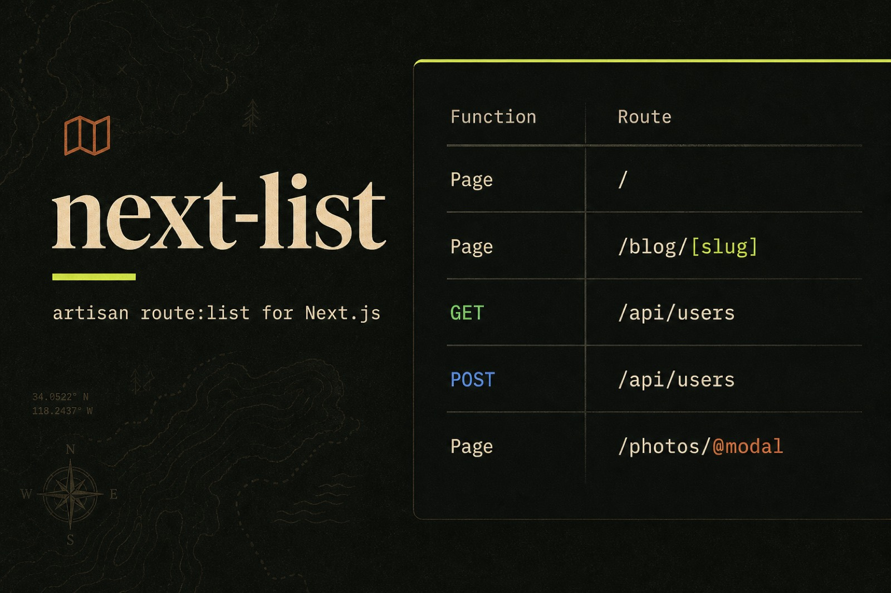
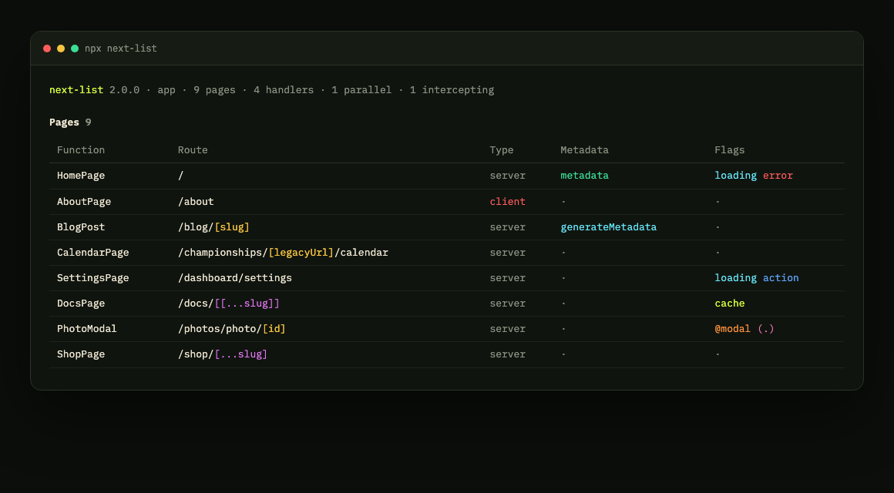
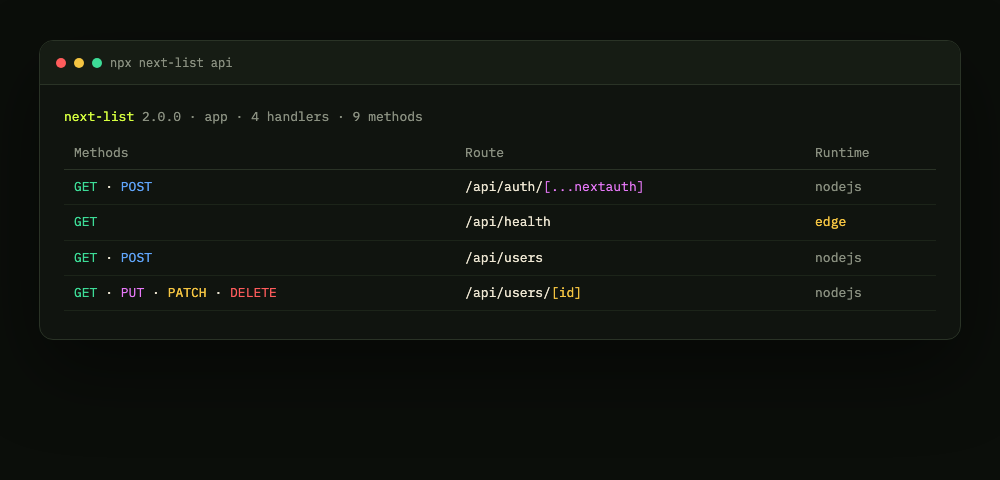
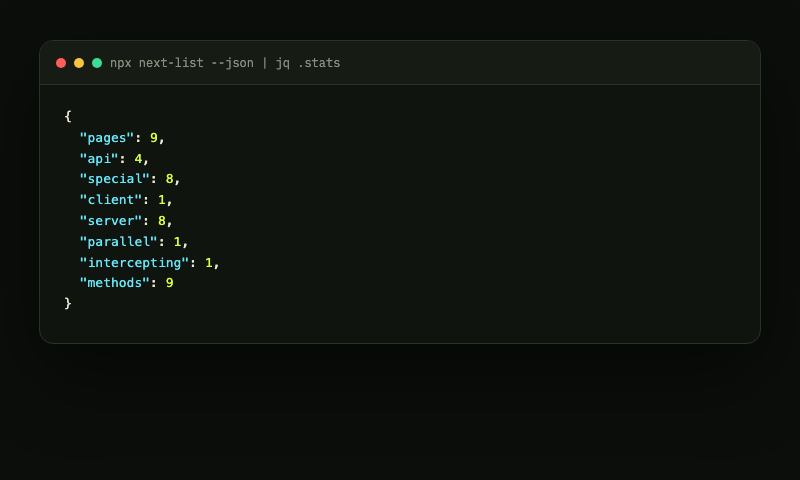
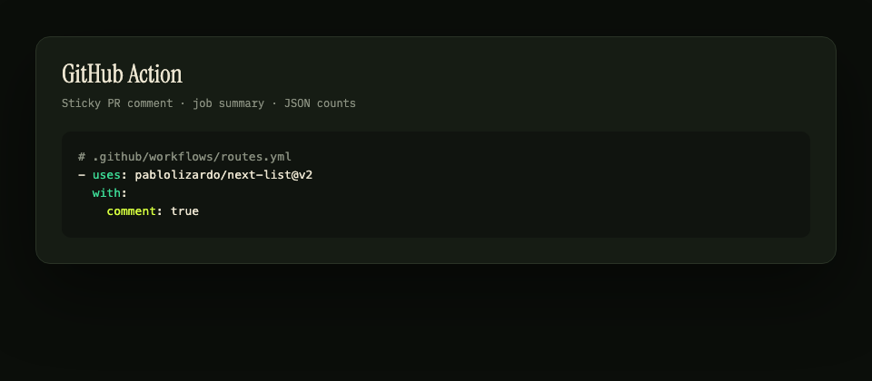
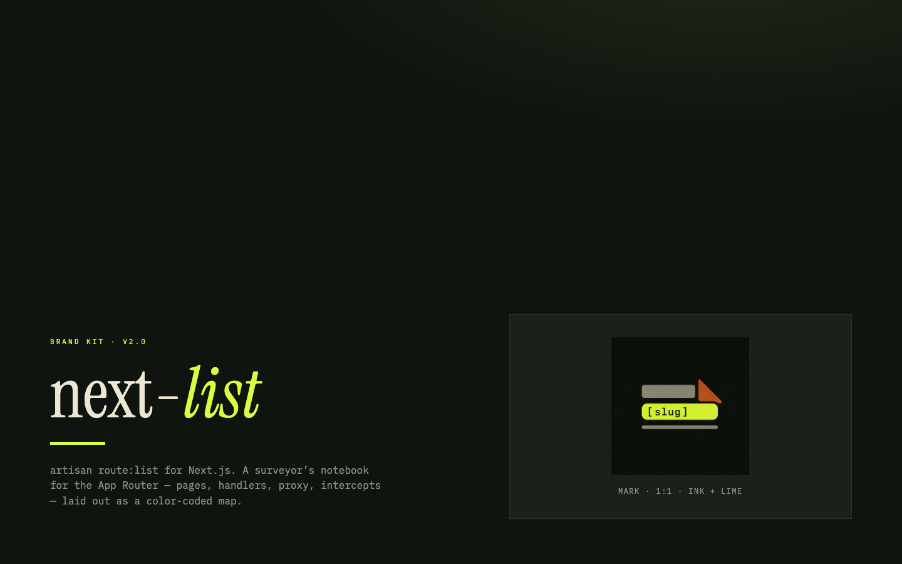

# next-list

[](https://www.npmjs.com/package/next-list)
[](https://github.com/pablolizardo/next-list/actions/workflows/ci.yml)
[](./LICENSE)

**artisan `route:list` for Next.js.** Point it at an App Router project and it prints every page, route handler and special file — with the URL Next actually serves, not the folder tree.

<p align="center">
  
</p>

```bash
npx next-list
```

<p align="center">
  
</p>

## Why v2

The original tool was a single `index.js` from late 2024. Next.js moved on (`proxy.ts`, `'use cache'`, `forbidden`, MDX pages) and two things users actually asked for were broken:

1. **Export to a file** dumped ANSI codes into `routes.md` ([#1](https://github.com/pablolizardo/next-list/issues/1))
2. **Route groups** like `(marketing)` leaked into the path, so `/(pages)/championships/[legacyUrl]/(with-layout)/calendar` was printed instead of `/championships/[legacyUrl]/calendar` ([#2](https://github.com/pablolizardo/next-list/issues/2))

v2 rebuilds the scanner around current App Router conventions and adds the outputs other tools can consume.

## Features

- Pages, `route.ts` handlers and special files (`proxy`, `sitemap`, `robots`, OG images, `instrumentation`)
- Correct URLs: strips `(route-groups)`, keeps `@parallel` and intercepts as flags
- Color-coded `[param]`, `[...catch]`, HTTP methods
- Client vs server, `metadata` / `generateMetadata`, `'use cache'`, server actions, loading/error UI
- JSON, markdown, tree, stats — and `--out file.md` with no escape codes
- GitHub Action that writes a job summary and can sticky-comment a PR
- Programmatic API: `const { scan } = require('next-list')`

## Screenshots

Pages (groups stripped, intercepts as flags):


Route handlers with method colors and Edge runtime:



Machine-readable stats for other tools:



GitHub Action on a pull request:



## Install

```bash
npx next-list
```

```bash
npm install -g next-list
next-list
```

```json
{
  "scripts": {
    "routes": "next-list --stats"
  }
}
```

Requires **Node 18+** and a Next.js app with `app/` or `src/app/`.

## Usage

```bash
next-list [pages|api|special] [options]
```

| Flag | What it does |
| --- | --- |
| `pages` / `api` / `special` | Show one table instead of all three |
| `-f`, `--full` | Prefix with `BASE_URL` or `APP_URL` |
| `-j`, `--json` | JSON (good for scripts) |
| `-m`, `--md` | GitHub-flavored markdown |
| `-t`, `--tree` | Filesystem tree + resolved URL |
| `--stats` | Counts after the table |
| `--verbose` | dynamic, revalidate, fetchCache, runtime, file |
| `--groups` | Keep `(route-groups)` in the path |
| `--fs` | Show folder paths instead of URLs |
| `--filter <text>` | Substring match on URL or file |
| `-o`, `--out <file>` | Write a file (markdown unless `--json`) |
| `--dir <path>` | Project root (default: cwd) |
| `--no-color` | Disable ANSI (also automatic when piping) |

```bash
npx next-list
npx next-list api --json
npx next-list --md --out routes.md
npx next-list --filter /blog --stats
```

Piping or `--out` turns colors off, so this stays a clean markdown table:

```bash
npx next-list --md > routes.md
```

## GitHub Action

```yaml
# .github/workflows/routes.yml
name: Routes
on: [pull_request]
jobs:
  list:
    runs-on: ubuntu-latest
    permissions:
      contents: read
      pull-requests: write
    steps:
      - uses: actions/checkout@v4
      - uses: pablolizardo/next-list@v2
        with:
          comment: true
```

| Input | Default | |
| --- | --- | --- |
| `project-path` | `.` | Next.js project directory |
| `comment` | `false` | Sticky-comment the PR (updates in place) |
| `filter` | | Substring filter |
| `groups` | `false` | Keep route groups in paths |

The action always appends the table to `$GITHUB_STEP_SUMMARY`.

## Programmatic API

```js
const { scan, render } = require('next-list')

const data = scan({ dir: process.cwd() })
console.log(data.stats)
// { pages: 9, api: 4, special: 8, client: 1, server: 8, ... }

const markdown = render(data, { markdown: true, command: 'all', color: false })
```

`scan()` returns `{ appDir, pages, api, special, stats }`. Each page includes `url`, `file`, `functionName`, `client`, `metadata`, UI flags, `parallel`, `intercept`, and segment config (`dynamic`, `revalidate`, `runtime`, `'use cache'`).

## What it understands

| Kind | Files |
| --- | --- |
| Pages | `page.{js,jsx,ts,tsx,mdx}` |
| Handlers | `route.{js,ts}` — `GET`/`POST`/… including `export const { GET, POST } = handlers` |
| UI | `loading`, `error`, `not-found`, `forbidden`, `unauthorized`, `template`, `default` |
| Next.js 16 | `proxy.ts` (and legacy `middleware.ts`) |
| Metadata | `sitemap`, `robots`, `opengraph-image`, `icon`, `instrumentation` |

Private folders (`_components`) are skipped. Route groups are omitted from the URL unless you pass `--groups`.

## Brand

Colors, mark and wordmark live in [`brand/`](./brand). Ink `#10140F`, paper `#EDE6D2`, lime `#D6FF3F`, copper `#C45C26`.

<p align="center">
  
</p>

## Contributing

```bash
npm install
npm test
node bin/next-list.js --dir fixtures/demo-app --stats
```

Bug reports and PRs: [github.com/pablolizardo/next-list](https://github.com/pablolizardo/next-list).

## License

MIT © [Pablo Lizardo](https://www.pablolizardo.dev)
